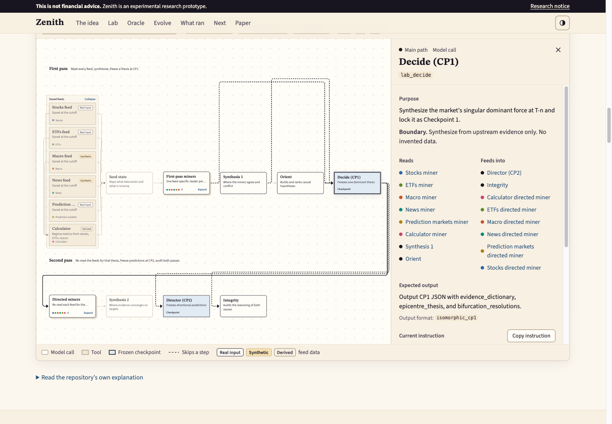

# Zenith

Zenith is a research prototype for testing changes to an AI reasoning graph.
It saves what each step received and produced, compares a prediction with later
observations, and uses the recorded failures to propose one change. The changed
procedure then needs a separate comparison on later cases.

> **This is not financial advice.** No forecasting improvement has been
> demonstrated for the current configuration. See the [research notice](RESEARCH_NOTICE.md).

[Run the offline example](#run-it) · [Paper](paper/zenith.pdf) ·
[Architecture](docs/architecture.md) · [Credits](#credits-and-license)



The [local teaching website](#open-the-teaching-website) lets you select a node
and read its instructions, inputs and expected output. The picture shows graph
definitions, not a completed forecast.

## How it works

**Lab → Oracle → Evolve → compare again.** The model weights stay fixed.
The experiment changes the instructions, context or connections in the graph.


| Step | What it does | Source |
|---|---|---|
| Lab | Freezes predictions from observations available at an earlier cutoff | [Runtime](zenith/runtime.py), [node definitions](codex/substrate/nodes/) |
| Oracle | Compares those predictions with later observations and proposes a failure hypothesis | [Scoring](feedback/engine.py), [failure diagnosis](research/failure_windows.py) |
| Evolve | Proposes one reviewed instruction or graph revision | [Evolve handoff](tools/refinement/run_evolve.py) |
| Comparison | Tests both versions on the same held-out later cases | [Matched comparison](research/daily_matchoff.py), [cohorts](research/cohort.py) |

A diagnosis suggests an experiment. It does not establish why a mistake happened
or whether a revision helps. The [research direction](docs/research-direction.md)
also proposes a controller that chooses small prompt variations from available
context; that controller has not been trained or evaluated.

## Run it

Use a source checkout with Python 3.11 or newer; CI uses Python 3.12.

```sh
git clone https://github.com/wcook04/plectis-zenith.git
cd plectis-zenith
python3 -m venv .venv
. .venv/bin/activate
python -m pip install -e '.[test]'
python -m zenith validate
python -m zenith plan lab
python -m zenith demo --output state/demo/offline-example
```

The offline example needs no inputs or credentials and makes no network or model
calls. It creates synthetic feed snapshots, runs the native Lab graph through
the engine and validation contracts, and shows a deliberately invalid response
being rejected and corrected. Open
`state/demo/offline-example/summary.json` for the actual completion counts and
evidence paths. This tests the protocol, not forecasting skill.

The command refuses a nonempty output directory and keeps generated files under
`--output`. Choose a new directory when running it again.

### Open the teaching website

After the Python setup above, install Node.js 22.12 or newer and run:

```sh
cd site
npm ci
npm run build
cd ..
python -m zenith serve --port 4175 --frontend-dir site/dist
```

Open [localhost:4175](http://localhost:4175). The read-only site serves the graph,
node instructions, paper and published examples. Public mode excludes saved
private runs. [The frontend guide](site/README.md) covers development and explicit
local run inspection; [the API guide](docs/website-backend.md) describes its routes.

### Optional: your own saved inputs

The separate mixed-data demonstration keeps real stock, ETF and prediction-market
inputs. Only macro and news are explicitly invented; CALC is recomputed from the
resulting inputs. With your own authorised saved snapshots:

```sh
python -m zenith prepare-demo --earlier-source /path/to/earlier \
  --later-source /path/to/later --output state/demo/my-pair
```

This prepares inputs without fetching data or calling a model. Follow the
[demo guide](docs/demo.md) to pass them through Lab and Oracle.
[Per-feed provenance](examples/demo/provenance.json) distinguishes the retained
real inputs from the invented examples. Raw real payloads stay local while their
publication permissions are reviewed. Withholding them does not make them
synthetic. See [data boundaries](docs/data.md).

The published mixed-data [preparation receipt](examples/demo/result.json) stops
at the first reasoning request: no model calls or completed forecasts for that
configuration. Earlier experiments are not results for it.

Provider execution is optional and requires explicit configuration and the
existing budget. It sends the assembled prompt and supplied data to that
provider. Use data you are entitled to send; keep personal financial information,
credentials and private run payloads out of the repository.

## Read more

The wider project is on the [Plectis website](https://wcook04.github.io/plectis/):
[system map](https://wcook04.github.io/plectis/#system),
[papers](https://wcook04.github.io/plectis/#papers) and
[films](https://wcook04.github.io/plectis/#videos). Zenith’s own teaching frontend
runs locally using the commands above.

For this experiment, start with the [paper](paper/zenith.pdf),
[graph diagrams](docs/graphs.md), [walkthrough script](docs/zenith-walkthrough-script.md)
and [current status](docs/status.md).

## Repository map

[Architecture](docs/architecture.md) follows one snapshot pair through the source
owners. Existing runtime and authored-graph paths are stable interfaces.

| Purpose | Files |
|---|---|
| Node instructions and dependencies | [codex/substrate/nodes/](codex/substrate/nodes/) |
| Execute Lab and Oracle | [zenith/](zenith/), [system/core/](system/core/) |
| Score forecasts and selections | [feedback/](feedback/) |
| Compare versions and diagnose failures | [research/](research/) |
| Inspect the mixed demonstration | [examples/demo/](examples/demo/), [demo guide](docs/demo.md) |
| Paper, diagrams and website screenshots | [paper/](paper/), [docs/](docs/) |
| Feed acquisition, refinement and shared execution | [tools/](tools/), [system/](system/) |
| Input adapters and reviewed graph variants | [benchmarks/](benchmarks/), [variants/](variants/) |
| Web frontend and its interaction tests | [site/](site/) |
| Offline regression tests | [tests/](tests/) |
| Graph projections and source checks | [scripts/](scripts/) |
| Agent guidance and CI | [AGENTS.md](AGENTS.md), [.agents/](.agents/), [.github/](.github/) |

## Check or contribute

```sh
make validate
make test
cd site
npm ci
npm test
npm run build
```

Validation checks the graph, extraction hashes and repository layout. The layout
checker uses Git candidates and skips ignored build trees; it rejects misplaced
Python tests, programs in narrative directories and unassigned root areas.
See [Contributing](CONTRIBUTING.md) and [Security](SECURITY.md).

## Credits and license

Created by Will Cook with AI coding agents. Zenith adapts the `ai_workflow`
research system; [NOTICE](NOTICE) and the
[extraction manifest](docs/extraction-manifest.json) record its source and
retained adaptations. The software is licensed under [Apache 2.0](LICENSE).

The teaching site uses React, React Flow and React Markdown. Its graph viewer,
node inspector and output viewer adapt the original research UI; the
[frontend guide](site/README.md#what-came-from-the-original-zenith-ui) describes
that reuse. STIX Two Text and Source Sans 3 retain their
[SIL Open Font Licenses](site/public/fonts/).

Software licensing does not grant redistribution rights to market feeds, news,
provider outputs or acquired datasets. Their provenance and permissions remain
separate from the code license.
