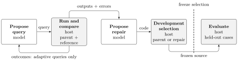

# Plectis Zenith

**Research prototype.** Zenith asks whether solving one software problem can leave behind a better way to investigate the next. It retains programs, executable tests and measured results, then checks what helps on later tasks.

[Watch the experiment](https://www.youtube.com/watch?v=A1Kw5hXvzVw) · [Read its study and replay instructions](docs/studies/kept-experience/README.md) · [Source map](#source-map) · [Contribute](CONTRIBUTING.md)

## The experiment in the film

Can an AI tester catch more bugs in new programs after reading a record of bugs
it missed before? The [Zenith film](https://www.youtube.com/watch?v=A1Kw5hXvzVw)
follows that experiment. The model receives a description of what each function
should do and chooses five test inputs. It cannot see the code it is testing,
and its weights are unchanged.

One faulty program should sort the numbers at every other position in a list, but crashes when the list is empty. Without the practice record, the tester missed that input in both attempts; with the record, it tried the empty list both times. The record contains earlier missed bugs and inputs that expose them.

Across 58 problems withheld from practice and development, tested twice each, DeepSeek V4.1 Flash caught an average **77.0% of the fault classes per problem**, compared with **69.2%** from the description alone. Faulty programs that fail on the same benchmark inputs count as one fault class.

About half the gain came from large inputs that made slow programs exceed the one-second time limit. Counting only wrong answers and exceptions, the smaller advantage had an uncertainty interval that included zero. Rules the model wrote from its misses did not produce a clear improvement.

This is one model on short benchmark functions, with no demonstrated transfer to larger software projects. The [study report](docs/studies/kept-experience/README.md) gives the comparisons, protocol changes, costs and limits. Its [paper](paper/zenith.pdf), saved replies and replay code are published at that fixed study revision on the `study/kept-experience-20261019` branch. Follow that report to reproduce the filmed experiment; the commands below run separate studies available on `main`.

| What you want to reproduce | Where to start |
|---|---|
| The bug-finding experiment in the video | [Study report and replay instructions](docs/studies/kept-experience/README.md) |
| A small local example without a model account | [Continuation learner demo below](#try-it-without-an-account), a separate authored algorithm |
| The earlier SQLite tester experiment | [Replay the saved client experiment](#replay-the-published-client-experiment), using its archived code and replies |

The [research website](https://wcook04.github.io/plectis-zenith/) and
[paper](paper/zenith.pdf) also describe the earlier studies.
Their [results and limits](docs/status.md) remain separate from the filmed experiment.

## Try it without an account

Use Python 3.11 or newer. Clone the repository, then run the small example with Python's standard library:

```sh
git clone https://github.com/wcook04/plectis-zenith.git
cd plectis-zenith
python3 scripts/demo_continuation_learning.py
```

This runs the separate **continuation learner**, an authored algorithm that uses answers to future tests to distinguish histories. Here it learns the output of a queue that holds at most four items, each equal to one. Appending more items produces the counts `0, 1, 2, 3, 4, 4, …`.

The JSON output includes these fields inside `minimal_witness`:

```json
{
  "source_calls": 10,
  "dimension_in_rational_linear_class": 5,
  "later_lengths_correct": 33
}
```

The learner makes ten queries to the source while fitting its model, then agrees with the queue on lengths 0–32. Those 33 later checks are additional source executions. Its five coordinates belong to the chosen rational-linear representation; one integer counter with the update `min(count + 1, 4)` solves this example more simply. The demonstration reproduces a specific learner repair, with the counter as its ordinary baseline.

For the eight-configuration diagnostic, including the remaining UTF-8 and SQLite errors, run:

```sh
python3 scripts/demo_continuation_learning.py --native
```

The [example guide](examples/continuation-memory/witness-preserving-v1/README.md) provides a command to compare the resulting measurements with the saved record. These learner commands require no account, dependency installation or network connection.

### Replay the published client experiment

Replay re-executes the saved experiment with its original replies and archived code. It checks whether the recorded queries and results can be reproduced; it does not ask a model to generate new answers.

On Linux, macOS or a suitable WSL environment, create a virtual environment and install this source checkout and its dependencies. Installation needs access to the Python package index; the replay makes no network or model calls.

```sh
python3 -m venv .venv
. .venv/bin/activate
python -m pip install -e '.[test,research]'
python scripts/build_client_investigation_report.py replay-behavior examples/conformance/client-reuse-v2-low
```

Success reports top-level `"ok": true` and `"status": "behavioral_match"` inside `archived_replay`. It checks all 46 recorded model attempts and compares queries, native results, work counters and reported costs. Those 46 attempts are read from the archive; they are not billed again. The replay also rechecks the separate 400-case client panel.

Both modes exclude timestamps, elapsed times and selected failure metadata. Behavioural replay additionally excludes SQLite version identity and reports both versions; differences in native results still fail. The [strict replay command](docs/studies/client/client-investigation-v2-low-20261015.md#evidence-and-replay) retains SQLite identity in the comparison. Both modes execute the bundle's frozen source, so replay does not test today's maintained implementation.

The [contribution guide](CONTRIBUTING.md#install-and-check-the-source-checkout) covers the complete test suite and building the website locally.

<a id="what-works-today"></a>

## Other studies

The studies below evaluate three mechanisms separately: model-proposed program repair, reuse of generated testers, and the authored continuation learner. The learner is not a component of either model-driven study. The earlier question-memory comparison is a separate controlled study of that learning approach.

| Study | Measured result | What the ordinary baseline tells us |
|---|---|---|
| [Native program repair](docs/studies/native/progress-campaign-20261014.md) | Repair without new investigation improves later answers from **259/576 to 365/576**. | No additional investigation method beats repair alone in aggregate. The twelve parent episodes cover three authored mechanisms. |
| [Reusable SQLite testers](docs/studies/client/client-investigation-v2-low-20261015.md) | Each generated tester finds **3 of 4 authored faults**, with no model calls on the five later clients. | The retained-procedure and ordinary-code conditions tie; both prepare model-generated code. Fixed tests find **4 of 4**. Neither generated tester changes its query in response to feedback. |
| [Continuation learner repair](examples/continuation-memory/witness-preserving-v1/README.md) | Keeping each new history with its distinguishing future test lets all **8 native configurations** finish fitting. | Seeding the same repaired learner with generic one-symbol questions costs **11,379** source executions versus **11,395** with its default seeds. Later UTF-8 and SQLite checks still find errors. |
| [Earlier controlled question memory](docs/history/continuation-memory.md) | Retaining acquired questions reduces additional queries by **11.2–63.1%**, with cached answers held identical. | Total joint learning costs **5,427–5,698** source executions versus **3,071** for separate ordinary modules. Blind question transfer later increases acquisition work on five of six targets. |

The complete client comparison records 46 model calls and $0.007117764 in reported inference charges across development, preparation of both testers and all target arms. The separate native diagnostic records 130 calls and $0.12982944; its two qualification runs bring these stages to 200 calls and $0.19002522. The adaptive-versus-masked difference comes from separate repairs given identical prompts before any second query decision, so it does not identify a feedback benefit. These are historical run costs; their linked reports retain earlier attempts and other work. The counts come from constructed, inspected workloads, not independent samples of applications.

Together, these results establish executable repair, tester reuse and a reproduced learner correction. They have yet to establish a net advantage for retained investigation procedures over the ordinary alternatives.

<a id="what-is-being-tested"></a>
<a id="how-it-works"></a>

## How native program repair works

Investigation conditions add tests before repair. Repair-only skips that step and requests a repair using the available examples.

1. **Choose a test.** A model, generated query-selection program or fixed schedule supplies inputs, according to the comparison condition.
2. **Execute it.** The host runs the candidate and reference separately and records their outputs and errors.
3. **Propose and select a repair.** The model receives the candidate code and available evidence, then returns replacement code. Development checks must preserve every previously correct measured case and a non-decreasing aggregate score.
4. **Freeze and evaluate.** Selection finishes before the held-out cases — inputs withheld from repair — are evaluated. Passing these finite checks does not prove correctness on every input.



Lab, Oracle and Evolve name execution, review and revision roles; they need not be separate agents. A model's explanation of a failure remains a hypothesis. The [native method](docs/studies/native/conformance-study.md) describes what evidence each condition receives. The client tester and continuation studies use their own protocols.

<a id="what-we-want-to-find-out"></a>

## What remains open

The next useful result would be a procedure that selects new, informative tests on independently chosen software and earns back its acquisition cost. The current client population leaves no room to outperform the fixed tester's fault count. A stronger evaluation needs fresh clients, matched preparation allowances for ordinary reusable code, and costs that include failed proposals and evaluation.

The [research programme](program.md#how-to-choose-the-next-experiment) proposes bounded tester refinement on development cases before freezing the tester for later clients. [CoverUp](https://arxiv.org/abs/2403.16218v4) supplies a relevant precedent: an authored driver uses coverage and execution feedback to refine generated regression tests. Coverage and fault detection measure different things.

A further question is whether experience improves the procedure that makes subsequent improvements. [STOP](https://arxiv.org/abs/2310.02304v3) studies recursively editing that procedure. Zenith has not implemented this connection. Its [proposed improver evaluation](program.md#improving-future-improvement) separates acquiring an improver from testing it on fresh starting programs. The possible [mathematics connection](program.md#mathematics-as-a-possible-transfer-domain) also remains a research direction. The paper and [reviewed source records](paper/references.json) place these proposals alongside the other cited methods.

## Source map

| To inspect | Start here |
|---|---|
| Filmed bug-finding study | [Study folder](docs/studies/kept-experience), including its evidence and replay guide |
| Small runnable example | [Demo](scripts/demo_continuation_learning.py) and [continuation learner](research/continuation_learning.py) |
| Measurements for the earlier studies | [Results and limits](docs/status.md) and the study reports linked above |
| Saved evidence and replay | [Client bundle](examples/conformance/client-reuse-v2-low), [replay command implementation](scripts/build_client_investigation_report.py), [learner record](examples/continuation-memory/witness-preserving-v1) |
| Implementation and dependencies | [Architecture and source owners](docs/architecture.md), [shared provider transport](system/lib/openrouter_free_runtime.py), [resource consumers](docs/architecture.md#resource-consumers) |
| Paper and reading website | [Paper guide](paper/README.md), [manuscript](paper/zenith.tex), [manuscript-to-web projection](zenith/paper_reading.py) |
| Earlier experiments | [Historical results](docs/history/status-20261015.md) and [retained graph architecture](docs/history/architecture.md) |

Frozen experiment copies preserve the code, prompts, unsuccessful attempts and measured costs used by each study. Current Markdown contracts have one owner under `codex/contracts/`; [source-custody rules](docs/architecture.md#documentation-and-evidence) explain their preservation and retirement.

The website projects the paper's prose, table, citations and diagram from the manuscript. Its [plain-text entry point](https://wcook04.github.io/plectis-zenith/llms.txt) provides routes for readers without JavaScript. Earlier experiments retain their own methods, populations and evidence; they are not pooled with the current results.

<a id="development"></a>
<a id="collaboration-and-guidance"></a>

## Contributing

Useful contributions include a small failure reproduction, a stronger ordinary baseline, an independently sourced software task, or a correction to a claim or citation. Start with the [contribution guide](CONTRIBUTING.md) for setup, relevant tests and evidence-preservation rules. `make demo` and `make replay` are shortcuts for the examples above; the guide explains the broader validation and website commands.

I'm developing Zenith with AI coding agents and learning the field as I go. Corrections and collaboration on prior work, useful tasks and fair evaluations are welcome through [project issues](https://github.com/wcook04/plectis-zenith/issues).

## Related projects

In the [Plectis introduction](https://www.youtube.com/watch?v=U1z2-XaLe_w),
Will explains why he uses AI to make its research and software easier for other
people to inspect. The [Plectis website](https://wcook04.github.io/plectis/)
collects the projects and their videos.

- [Safety Core](https://github.com/wcook04/safety-core) compares written agent rules with executable checks in a small coding task. Its experiment asks a different question from Zenith's tester study.
- [One Checkout](https://github.com/wcook04/one-checkout) commits a reviewed patch while preserving other unfinished edits in the same project folder.
- [Plectis toolkit](https://github.com/wcook04/plectis) contains Python components and worked experiments; [Plectis Erdős](https://github.com/wcook04/plectis-erdos) contains the mathematical research, papers and proofs.

<a id="credits-and-license"></a>

## Credits and licence

Will Cook built and directed the research infrastructure and reviewed the claims when he could. AI agents did most of the research and drafting. Cook did not independently verify every claim. The paper and web edition carry the same disclosure. [NOTICE](NOTICE) records the `ai_workflow` ancestry and attributed research-return components. The software uses the [Apache 2.0 licence](LICENSE); dataset and provider-response rights are separate. The [paper guide](paper/README.md) and [research programme](program.md) retain the literature and links to related Plectis research.
