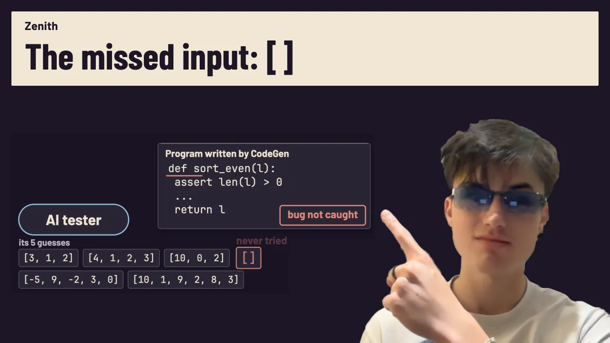

# Plectis Zenith

[Will Cook’s home page: all projects and videos](https://wcook04.github.io/)

Zenith is a collection of experiments on using AI to find and fix software bugs.
The main question is whether records of earlier mistakes help an AI tester
find bugs in programs it has not seen before.

This repository contains experiment code, saved model replies, measured results
and instructions for repeating the checks. It is a research prototype. The
video study and the older studies use different code versions; their links
below identify which one to use.

[Watch the experiment](https://www.youtube.com/watch?v=wUxp2Wohmq0) · [Read its study and replay instructions](docs/studies/kept-experience/README.md) · [Source map](#source-map) · [Contribute](CONTRIBUTING.md)

<a id="the-experiment-in-the-film"></a>

## The experiment in the video

Can an AI tester catch more bugs in new programs after reading a record of bugs
it missed before? The [Zenith video](https://www.youtube.com/watch?v=wUxp2Wohmq0)
follows that experiment. The model receives a description of what each function
should do and chooses five test inputs. It cannot see the code it is testing,
and it is not retrained: the earlier mistakes are added to the text it reads.

One faulty program should sort the numbers at every other position in a list, but crashes when the list is empty. Without the practice record, the tester missed that input in both attempts; with the record, it tried the empty list both times. The record contains earlier missed bugs and inputs that expose them.

[](https://www.youtube.com/watch?v=wUxp2Wohmq0)

[Watch the five-minute experiment](https://www.youtube.com/watch?v=wUxp2Wohmq0).

Across 58 problems withheld from practice and development, tested twice each, DeepSeek V4.1 Flash caught an average **77.0% of the fault classes per problem**, compared with **69.2%** from the description alone. Faulty programs that fail on the same benchmark inputs count as one fault class.

About half the gain came from large inputs that made slow programs exceed the one-second time limit. Counting only wrong answers and exceptions, the smaller advantage had an uncertainty interval that included zero. Rules the model wrote from its misses did not produce a clear improvement.

This is one model on short benchmark functions, with no demonstrated transfer to larger software projects. The [study report](docs/studies/kept-experience/README.md) gives the comparisons, protocol changes, costs and limits. Its [paper](paper/zenith.pdf), saved replies and replay code are published at that fixed study revision on the `study/kept-experience-20261019` branch. Follow that report to reproduce the experiment shown in the video; the commands below run separate studies available on `main`.

| What you want to reproduce | Where to start |
|---|---|
| The bug-finding experiment in the video | [Study report and replay instructions](docs/studies/kept-experience/README.md) |
| A small local example without a model account | [Continuation learner demo below](#try-it-without-an-account), a separate authored algorithm |
| The earlier SQLite tester experiment | [Replay the saved client experiment](#replay-the-published-client-experiment), using its archived code and replies |

The [research website](https://wcook04.github.io/plectis-zenith/) and
[paper](paper/zenith.pdf) also describe the earlier studies.
Their [results and limits](docs/status.md) remain separate from the experiment shown in the video.

## Try it without an account

Use Python 3.11 or newer. Clone the repository, then run the small example with Python's standard library:

```sh
git clone https://github.com/wcook04/plectis-zenith.git
cd plectis-zenith
python3 scripts/demo_continuation_learning.py
```

This is a separate demonstration, not the AI tester shown in the video. An
algorithm learns to predict the output of a queue that holds at most four items,
each equal to one. Inserting more items produces counts `0, 1, 2, 3, 4, 4, …`.
The code calls this algorithm a **continuation learner**: it uses the answers to
later tests to distinguish earlier input sequences.

The program prints JSON, text with named fields. Look inside `minimal_witness`:

```json
{
  "source_calls": 10,
  "dimension_in_rational_linear_class": 5,
  "later_lengths_correct": 33
}
```

The learner asks the queue for ten outputs while fitting its prediction model.
It is then checked on sequences of length 0–32 and gets all 33 answers right.
Those later checks run the queue another 33 times. The value `5` describes the
number of coordinates in the mathematical representation used by this learner.
An ordinary integer counter with the update `min(count + 1, 4)` solves this
example more simply. The demo reproduces a repair to the learner; it does not
show that this approach beats the counter.

For the eight-configuration diagnostic, including the remaining UTF-8 and SQLite errors, run:

```sh
python3 scripts/demo_continuation_learning.py --native
```

The [example guide](examples/continuation-memory/witness-preserving-v1/README.md) provides a command to compare the resulting measurements with the saved record. These learner commands require no account, dependency installation or network connection.

### Replay the published client experiment

Replay re-executes the saved experiment with its original replies and archived code. It checks whether the recorded queries and results can be reproduced; it does not ask a model to generate new answers.

On Linux, macOS or a suitable WSL environment, create a virtual environment and install this source checkout and its dependencies. Installation needs access to the Python package index; the replay makes no network or model calls.

```sh
python3 -m venv .venv
. .venv/bin/activate
python -m pip install -e '.[test,research]'
python scripts/build_client_investigation_report.py replay-behavior examples/conformance/client-reuse-v2-low
```

Success reports top-level `"ok": true` and `"status": "behavioral_match"` inside `archived_replay`. It checks all 46 recorded model attempts and compares queries, native results, work counters and reported costs. Those 46 attempts are read from the archive; they are not billed again. The replay also rechecks the separate set of 400 test cases.

The replay command above and a stricter variant both exclude timestamps, elapsed times and selected failure metadata. Behavioural replay additionally excludes SQLite version identity and reports both versions; differences in native results still fail. The [strict replay command](docs/studies/client/client-investigation-v2-low-20261015.md#evidence-and-replay) retains SQLite identity in the comparison. Both modes execute the bundle's frozen source, so replay does not test today's maintained implementation.

The [contribution guide](CONTRIBUTING.md#install-and-check-the-source-checkout) covers the complete test suite and building the website locally.

<a id="what-works-today"></a>

## Other studies

These are separate experiments. Their results are not combined with the
bug-finding study shown in the video.

- **[Program repair](docs/studies/native/progress-campaign-20261014.md).** Asking
  the model to repair code using the available examples increased correct later
  answers from **259/576 to 365/576**. Giving it additional investigation steps
  did not beat repair alone overall. The tasks were constructed for this study.
- **[Reusable SQLite testers](docs/studies/client/client-investigation-v2-low-20261015.md).**
  SQLite is a database library. Two model-generated testing programs each found
  **3 of 4 deliberately introduced faults**, without further model calls on five
  later programs. Ordinary fixed tests found **4 of 4**. Neither generated tester
  changed its next query in response to the database's answers.
- **[Continuation learner repair](examples/continuation-memory/witness-preserving-v1/README.md).**
  A correction let all **8 tested configurations** finish fitting. Using generic
  starting questions required **11,379** source executions versus **11,395** with
  the default questions. Later text-encoding and SQLite checks still found errors.
- **[Earlier question-memory study](docs/history/continuation-memory.md).**
  Keeping previously acquired questions reduced additional queries by
  **11.2–63.1%**, but the combined learning procedure still used more source
  executions than separate ordinary modules. Transferring questions without
  checking their relevance later increased work on five of six targets.

The linked reports include model calls, costs and unsuccessful attempts. These
studies demonstrate particular repairs and reusable testers; they have not
established an overall advantage over the ordinary alternatives.

<a id="what-is-being-tested"></a>
<a id="how-it-works"></a>

<a id="how-native-program-repair-works"></a>

## How the program-repair experiment works

Some versions of the experiment ask for extra tests before requesting a fix.
The comparison version asks for a fix using only the examples already available.

1. **Choose a test.** A model, generated query-selection program or fixed schedule supplies inputs, according to the comparison condition.
2. **Execute it.** The test runner executes the proposed program and a reference program separately, recording their outputs and errors.
3. **Propose and select a repair.** The model receives the candidate code and available evidence, then returns replacement code. A proposed repair must keep every previously correct test case correct, without reducing the total score.
4. **Freeze and evaluate.** Selection finishes before the held-out cases — inputs withheld from repair — are evaluated. Passing these finite checks does not prove correctness on every input.


The code uses the names Lab, Oracle and Evolve for running tests, reviewing results and revising code. They need not be separate AI agents. A model's explanation of a failure is a proposed explanation, not an established cause. The [native method](docs/studies/native/conformance-study.md) describes what evidence each condition receives. The client tester and continuation studies use their own protocols.

<a id="what-we-want-to-find-out"></a>

## What remains open

A useful next test needs independently chosen software, ordinary testing code
as a fair comparison, and a count of all the work spent preparing each tester.
The current database examples cannot show a higher fault count than fixed tests:
the fixed tests already find all four faults.

The [research plan](program.md#how-to-choose-the-next-experiment) describes these
next experiments and related research, including
[CoverUp](https://arxiv.org/abs/2403.16218v4), which uses test coverage and execution
feedback to refine tests, and [STOP](https://arxiv.org/abs/2310.02304v3), which
studies improving the procedure that makes later improvements. Applying those
ideas to Zenith, or transferring them to
[mathematics](program.md#mathematics-as-a-possible-transfer-domain), remains
proposed work.

## Source map

For directory roles and implementation boundaries, see the [architecture guide](docs/architecture.md#repository-roles).

| To inspect | Start here |
|---|---|
| Bug-finding study in the video | [Study folder](docs/studies/kept-experience), including its evidence and replay guide |
| Small runnable example | [Demo](scripts/demo_continuation_learning.py) and [continuation learner](research/continuation_learning.py) |
| Measurements for the earlier studies | [Results and limits](docs/status.md) and the study reports linked above |
| Saved evidence and replay | [Client bundle](examples/conformance/client-reuse-v2-low), [replay command implementation](scripts/build_client_investigation_report.py), [learner record](examples/continuation-memory/witness-preserving-v1) |
| Implementation and dependencies | [Architecture and source owners](docs/architecture.md), [code for calling model providers](system/lib/openrouter_free_runtime.py), [which programs read each resource](docs/architecture.md#resource-consumers) |
| Paper and reading website | [Paper guide](paper/README.md), [manuscript](paper/zenith.tex), [code that turns the manuscript into web pages](zenith/paper_reading.py) |
| Earlier experiments | [Historical results](docs/history/status-20261015.md) and [retained graph architecture](docs/history/architecture.md) |

Saved experiment copies keep the exact code, prompts, unsuccessful attempts and costs used in each study. Current written requirements live under `codex/contracts/`. The [preservation guide](docs/architecture.md#documentation-and-evidence) explains which files can be updated and which must remain unchanged.

The website is generated from the paper's text, table, citations and diagram. Its [plain-text entry point](https://wcook04.github.io/plectis-zenith/llms.txt) provides routes for readers without JavaScript. Earlier experiments retain their own methods, populations and evidence; they are not pooled with the current results.

<a id="development"></a>
<a id="collaboration-and-guidance"></a>

## Contributing

Useful contributions include a small failure reproduction, a stronger ordinary comparison method, an independently sourced software task, or a correction to a claim or citation. Start with the [contribution guide](CONTRIBUTING.md) for setup, relevant tests and evidence-preservation rules. `make demo` and `make replay` are shortcuts for the examples above; the guide explains the broader validation and website commands.

I'm developing Zenith with AI coding agents and learning the field as I go. Corrections and collaboration on prior work, useful tasks and fair evaluations are welcome through [project issues](https://github.com/wcook04/plectis-zenith/issues).

## Related projects

In the [Plectis introduction](https://www.youtube.com/watch?v=MBmVMMogXTA),
Will explains why he uses AI to make its research and software easier for other
people to inspect. [Will Cook's home page](https://wcook04.github.io/)
collects the projects and their videos.

- [Safety Core](https://github.com/wcook04/safety-core) compares written agent rules with executable checks in a small coding task. Its experiment asks a different question from Zenith's tester study.
- [One Checkout](https://github.com/wcook04/one-checkout) commits a reviewed patch while preserving other unfinished edits in the same project folder.
- [Plectis toolkit](https://github.com/wcook04/practical-formal-verification) contains Python components and worked experiments; [Plectis Erdős](https://github.com/wcook04/plectis-erdos) contains the mathematical research, papers and proofs.

<a id="credits-and-license"></a>

## Credits and licence

Will Cook built and directed the research infrastructure and reviewed the claims when he could. AI agents did most of the research and drafting. Cook did not independently verify every claim. The paper and web edition carry the same disclosure. [NOTICE](NOTICE) records the `ai_workflow` ancestry and identifies code or research contributed from other sources. The software uses the [Apache 2.0 licence](LICENSE); dataset and provider-response rights are separate. The [paper guide](paper/README.md) and [research programme](program.md) retain the literature and links to related Plectis research.
