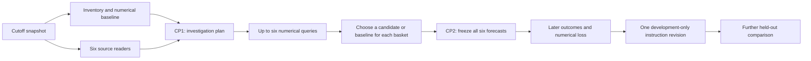

# Shared-universe basket experiment

Zenith forecasts the next five market-session returns of six research baskets. Every forecast can use the histories of all 147 formation-eligible instruments, all six baskets and 17 available market indices. The language model chooses which relationships to inspect; numerical code fits and evaluates the forecasts.

This is an executable profile of the existing engine. Its source is `zenith/basket_panel.py`, `tools/baskets/numeric.py`, `codex/substrate/nodes/basket/` and `research/basket_study.py`. The legacy Lab and Oracle missions remain separate. The basket evaluator computes losses directly instead of asking a language model to judge numerical accuracy.

## Data and target

The [data record](data.md) identifies the pinned, dataset-licensed NEPSE files and their import audit. The market calendar is the intersection of dates with NEPSE-index and instrument observations. Formation uses the last such session at or before 30 December 2021: 29 December 2021. An instrument needs at least 95% quote coverage in the preceding 252 sessions, a formation-date quote and positive median source volume.

The 147 eligible instruments are sorted by their preceding 126-session beta to the equal-weight universe, then divided into six balanced groups. These are behavior-based research baskets, not economic sectors, historical ETF memberships or an investable strategy. Source metadata does not reliably classify instrument types.

Each basket starts at 100 with equal initial value in its members and keeps those shares fixed. Its target is the fractional change in that index over five subsequent market sessions. Missing prices carry the last observed quote forward; quote age and basket stale fraction remain visible. A stale mark is not a price at which one could sell. There is no future-survival filter, constituent deletion, future backfill or rebalancing based on test outcomes.

## Numerical store and investigation

Each cutoff exports only feature rows through that date and labels whose five-session horizon has already matured. It contains at most 252 training origins. Features include constituent returns over 1, 5 and 20 sessions, 20-session volatility and relative volume, quote age, basket returns, breadth and dispersion, and index returns. The raw import retains supplied open, high, low, close and volume fields; this first feature catalogue uses close and volume.

The common baseline is a ridge regression using the entire feature universe. Scaling is fitted on training rows, standardised values are clipped to ±10, the kernel is divided by feature count and the fixed ridge penalty is 100. A zero-return forecast supplies a further reference. Neither baseline receives hidden future labels.

An investigation chooses a target basket, any source basket or `ALL` or `INDEX`, a feature family, and a lag in {0, 1, 5, 20} sessions. The tool fits the same ridge procedure to that feature subset. It returns a candidate forecast and its improvement over the common baseline on eight earlier rolling validation origins. Training labels must mature before each validation origin. A positive validation gain is a selection diagnostic; it is not test performance. Index queries support trend or all-feature lag operations.

This is a deliberately bounded catalogue, not arbitrary code generation or a claim that the system has discovered causality. It makes a concrete version of the question testable: can the model choose useful distinctions among sources, feature families and times?

## Native graph and comparisons



CP1 saves an immutable plan. Its provisional forecast is the common numerical baseline. CP2 can reject the initial hypotheses and must select exactly one allowed forecast for every basket. Uninvestigated targets retain their baseline. Forecast values come from tools, never invented arithmetic in model output.

| Arm | First pass and second pass | Model calls per origin |
|---|---|---:|
| Numerical | All-universe ridge only | 0 |
| Zero | Zero return for every basket | 0 |
| Undirected | Six readers and planner; replace proposed queries with six fixed own-basket trend queries; final selection | 8 |
| Directed | Six readers and planner; execute up to six selected queries; final selection | 8 |
| Revised | Directed graph with one frozen instruction addition to its planner | 8 |
| Serial | One controller sees all first-pass numerical rows, chooses up to six queries, then selects forecasts | 2 |

The serial controller has the same data, target set and query catalogue. Its smaller actual cost is reported. It may outperform the graph; the experiment does not assume that many model calls are necessary. Directed and undirected arms share a maximum query allowance, not necessarily identical executed-query counts. Their readers run independently. This small pilot does not isolate reader sampling variation or establish an advantage over every possible serial programme.

## Development, evolution and scoring

Four development origins begin in February, May, August and November 2023; the exact dates are the first available sessions on or after each prescribed date. Directed and undirected arms commit forecasts before each outcome is scored. Evolve receives these development scores and saved traces, then proposes one planner instruction of at most 512 characters. No base-model weights change. The revision and its hash are saved before held-out execution.

Six held-out origins begin in February, April, June, August, October and December 2024. All four model arms commit before each outcome is scored. Every arm is scored on the same six baskets. The primary loss is mean squared fractional return error, averaged equally over baskets and origins. A failed native run keeps the entire numerical baseline vector, remains in the score, and is reported as a failure.

The revision is retained only if aggregate held-out loss is strictly lower than the directed incumbent, worst-origin loss does not increase, and no model arm has failed. Otherwise the incumbent stays. The intended completed batch uses 221 calls, including one Evolve call; the hard shared budget permits at most 260 calls and $2. Actual token counts, cost, failures and query counts are saved.

There are six held-out dates, not 36 independent market experiments. Baskets share sources and outcomes within a date are dependent. This first run tests execution and yields a descriptive comparison. It does not establish statistical superiority, causal market knowledge, trading profitability or generalisation beyond the sampled dates. The publisher-adjusted snapshot lacks historical release timestamps and adjustment vintages, and pretrained models may have encountered these historical events. A prospective evaluation remains necessary.

## Reproduce

```sh
python -m pip install -e '.[test,research]'
python -m zenith basket fetch --output work/data/nepse-source
python -m zenith basket ingest --source work/data/nepse-source \
  --output work/data/nepse-through-2025 --through 2025-12-31
python -m zenith basket prepare --data work/data/nepse-through-2025 \
  --study work/basket-study --model inclusionai/ling-3.0-flash
python -m zenith basket run --study work/basket-study --env-file /path/to/local.env
python -m zenith basket report --study work/basket-study
```

Only `run` makes inference calls. `fetch` downloads the pinned source; it never executes the upstream collection scripts. Source and snapshot destinations must be new. Runtime code, node definitions, data and study protocol are hashed. An interrupted paid call is not silently resent. Private runtime artifacts remain under ignored `work/` and `state/`; published evidence contains a reviewed subset.

The [status record](status.md) distinguishes completed measurements from this protocol. The older [System A fixture](demo.md) remains useful for generic observation-contract tests.
