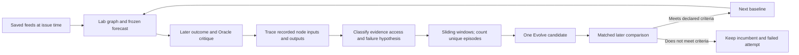

# Trace a failure before changing the graph

> **This is not financial advice.** This is experimental research. Historical
> examples and model outputs are not investment recommendations and must not be
> used to make financial decisions. See the [research notice](../RESEARCH_NOTICE.md).

Start with the original loop: save the feeds at the issue time, run the full
Lab, freeze its selection and forecasts, then compare with later observations.
The object being learned is the procedure that turns that information into a
selection and a forecast. A disappointing outcome starts an investigation; it
does not identify the defective reasoning step.



The existing [Oracle critique contract](../codex/substrate/contracts/schema_cp2_critique.json)
already distinguishes `OBSERVATION_MISS`, `OBSERVATION_NOISE`, `SYNTHESIS_BLIND`,
`SYNTHESIS_LEAP`, `PREDICTION_DRIFT` and `EXOGENOUS_SHOCK`. Keep those classes.
Add a separate question: **where was the relevant information at issue time?**

The earlier design's **K-class matrix** was more specific about location:

| Original class | Proposed interpretation |
|---|---|
| `K0` | Genuinely unknowable at the issue time |
| `K2` | Available somewhere, outside the chosen information universe |
| `K1_SURF` | Present in a feed, not surfaced by its miner |
| `K1_GROUP` | Surfaced pieces were not connected across lanes |
| `K1_PROM` | A supported claim was not promoted into the thesis |
| `K1_FALS` | A critic incorrectly rejected a supported claim |
| `K1_INF` | The thesis was adequate, but its predicted consequences were wrong |
| `K1_DIR` | A useful prediction was proposed, then dropped by the director |

That is the original backwards-tracing idea. These were design hypotheses for
an earlier topology, not a verified one-to-one map onto today's node IDs. The
current Oracle error class, the evidence-access state and the reviewed graph
location answer different questions. Retain the original K distinction in the
reviewed mechanism when it fits; do not mechanically translate one vocabulary
into the other. A missing ledger ID does not prove the underlying information
was absent or that dropping it was wrong. A node's declared duty and permitted
scope constrain a proposed patch; they do not establish blame.

In particular, `K0` cannot be established just by failing to find evidence.
Do not remove a forecast loss from the evaluation denominator merely because
an explanation calls it unknowable. Keep the measured outcome and the uncertain
attribution separate. This also preserves the later design correction: code
can diff and trace recorded artifacts; explaining the discrepancy is a reasoning
task, and deciding whether the remedy works is an experiment.

| Evidence state | What to investigate | What the state does not establish |
|---|---|---|
| In the recorded node input | Interpretation, synthesis, calibration or decision | That this information should have predicted the outcome |
| In the saved universe, absent from this node's input | Acquisition-to-node route, extraction, compression or selection | Which upstream node first lost it |
| Outside the saved universe, available before the cutoff | Whether an additional historical source would help | That the original graph could have used it |
| Became available after the cutoff | A later event or information arrival | That the outcome was necessarily unforeseeable |
| Unknown | Missing trace, uncertain clocks, incomplete source inventory or unresolved mechanism | Permission to choose a convenient explanation |

Missing truth prices are a measurement gap. Missing feed inputs are a data gap.
Neither becomes a model error. An `EXOGENOUS_SHOCK` label is still an Oracle
hypothesis; absence from one snapshot is not evidence of an unforeseeable shock.

## Work backwards through recorded inputs and outputs

Follow the forecast to its justification, the selected thesis, the cross-feed
synthesis and the relevant miners and feed records. At each transition, compare
the actual input with the actual output. Keep competing explanations. A downstream
symptom can originate upstream; a useful source omitted from the final evidence
dictionary may still have been present in a miner's prompt.

`research.diagnosis.observe_run` supplies mechanical runtime observations.
`research.failure_windows` reads the native Oracle critique, reconciliation,
subject index, Lab manifest and prompt-bound requests. It checks the subject
bytes frozen by Oracle. It preserves missing or invalid evidence as unresolved,
and retains an explicit `NO_FINDINGS` review without converting it into success.

An optional reviewed annotation identifies a node, a reusable mechanism and an
evidence state. It must quote a complete prompt and a node output, with file
hashes and JSON pointers; an in-universe claim also cites subject evidence.
The complete prompt is needed to review absence, not merely one convenient
excerpt. The reviewer must explain the source inventory searched and alternatives
considered. Hashes prove which bytes were reviewed, not that the review is right.
The first defective transition and causal sufficiency remain hypotheses until
intervention tests support them. Prompt records describe supplied context; they
do not reveal hidden reasoning or prove that the model attended to an item.

External research is useful for discovering explanations and candidate sources.
Record it as external, with its own availability time. It cannot become historical
subject evidence merely because it explains the result well. An availability
timestamp supplied by a reviewer is itself a claim to audit against the source.
If the proposal expands the data universe, test it as an input change separately
from a reasoning change. Do not rewrite the original forecast or evidence.

## Repeat over origins and widths

The read-only entry point is:

```sh
python -m research failure-windows \
  --oracle-run state/runs/<first-oracle-run> \
  --oracle-run state/runs/<second-oracle-run> \
  --widths 1 2 5 --stride 1 > work/failure-windows.json
```

The caller supplies the episode inventory explicitly. Windows slide across
chronologically ordered forecast episodes within each recorded graph version.
Width means the number of episodes in an analysis window. A forecast's original
horizon never changes. To compare different forecast horizons, issue and freeze
forecasts for each horizon first; do not grade a one-day forecast as a week-long
one. Unsupported widths remain visible rather than creating invented runs.

The report preserves every episode, including abstentions, data gaps and unresolved reviews.
An abstention is kept as its own outcome, not counted as a data failure or a
successful prediction; judging selection still requires the full-universe scorer.
It lists the individual cases inside each window, then aggregates **unique
episodes**, not window appearances. It also reports a maximum set of
nonoverlapping forecast intervals. Several asset errors on one day are several
cases but one episode. Nonoverlapping intervals can still share market regimes
and are not certified independent observations. Different recorded graph,
policy, context and execution configurations remain separate strata.

To add a reviewed location, pass `--annotations <file>`. The JSON object contains
an `annotations` array. Each entry has exactly these fields:

```json
{
  "case_id": "<from the report>",
  "node_id": "lab_director",
  "evidence_state": "in_node_context",
  "mechanism": "comparison_against_prior_guidance",
  "rationale": "<input-to-output discrepancy, alternatives and limits>",
  "reviewer": "<author>",
  "citations": [
    {
      "role": "node_input",
      "path": "<absolute path to the recorded handoff request>",
      "sha256": "<file SHA256>",
      "pointer": "/prompt",
      "value": "<exact complete prompt>"
    }
  ]
}
```

The example shows one citation's shape; a valid annotation also needs
`node_output` and, for either in-universe state, `subject` citations. Artifact
citations point into `/data/...`. External citations have role `external` and
an additional timezone-qualified `available_at`. A pre-cutoff external claim
cannot use a later timestamp; a post-cutoff claim requires one. Changed bytes,
incorrect quotes, wrong-node prompts, unknown cases and duplicate annotations
are rejected. An unannotated case stays unlocalized. Neither a label nor a
successful quote check grants causal authority.

## One candidate, then a later comparison

Within each graph version, repeated node-and-mechanism hypotheses are ranked by
nonoverlapping episode count, then total episode count. This is a transparent
starting priority, not a claim that frequency alone measures importance. The
report names a next intervention hypothesis only when a reviewed, in-universe
node mechanism recurs in at least two nonoverlapping episodes. External-source
and unresolved cases remain visible but do not recommend a reasoning patch.

Use the existing daily Evolve review to propose one bounded change. Rerun old
cases as a regression check; improvement there is development feedback. Freeze
the candidate and compare it with the incumbent on the same later inputs through
the existing `daily matchoff` and `daily retain` path. Keep the selection
denominator, forecast loss, missingness, cost and failed attempts visible.
Predeclare the tolerated regressions and important subgroups before comparison.
A broad average can hide damage in one regime. The diagnostic report does not
implement those acceptance criteria or authorize retention.

Finite historical tests cannot establish universal improvement. If the declared
later comparison supports retaining the candidate, it becomes the next baseline;
the next cycle starts after that comparison's outcomes have matured. Preserve
rejected changes too. This is the original Lab → Oracle → Evolve loop with a
testable link between diagnosis and intervention, not an oracle that knows the
cause of every forecast error.

An execution failure can stop this loop before any prediction exists. Keep its
mechanism separate from the epistemic matrix: output truncation at a grouping
node does not by itself establish a grouping or reasoning error. A native schema pass,
obedience to an instruction, complete graph execution and forecast benefit are
separate outcomes. The [current demo](demo.md) stops at preparation and makes no
claim about a completed reasoning or intervention test.
