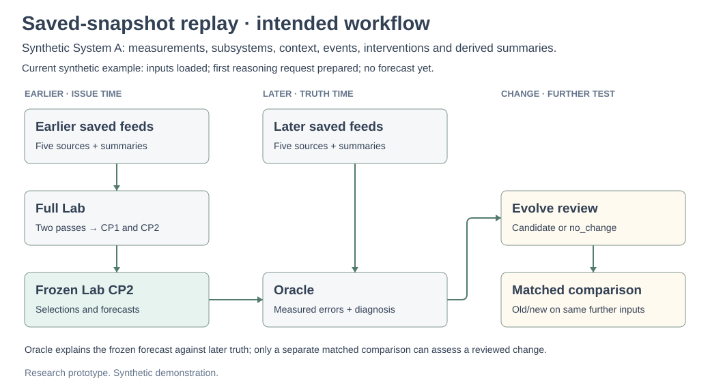
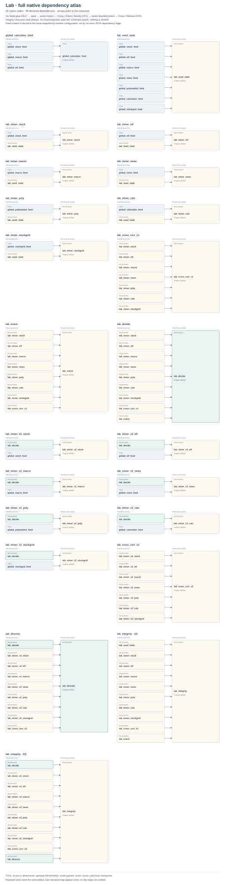
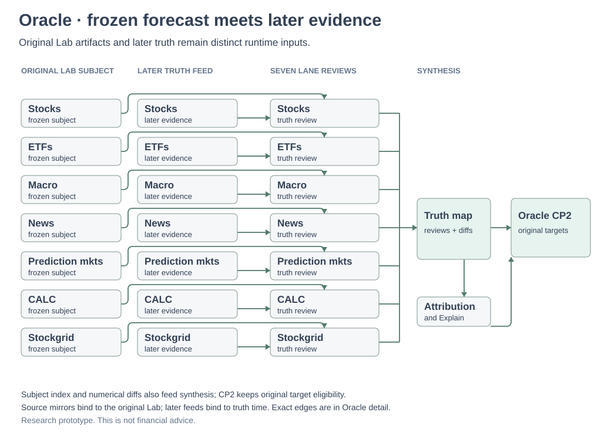
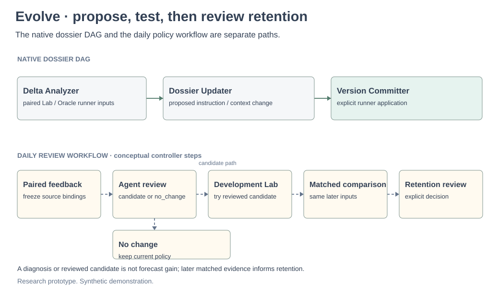

# Actual graph diagrams

The new [adaptive investigator](graphs/investigator-detail.svg) is the bounded
native execution scaffold for [investigator v1](investigator.md). Each run exports
its actual active dependencies in `execution_graph.json`; inactive slots make no
model calls. The two-node review mission receives later evidence separately.

The historical basket profiles are [the directed graph](graphs/basket-detail.svg) and
[the serial controller](graphs/basket-serial-detail.svg). Their numerical evaluator
and development-only Evolve comparison are described in [the basket protocol](baskets.md).
The diagrams below describe the separate legacy System A profile.

> **Experimental research prototype.** The example uses invented observations.
> See the [research notice](../RESEARCH_NOTICE.md).

The [saved-snapshot replay](graphs/replay.svg) shows the intended workflow.
The current example uses five invented perspectives on System A. A sixth feed
computes summaries from those observations; it is not independent evidence.
It has prepared the first reasoning request, with no forecast yet.
See [current status](status.md) and [per-feed provenance](../examples/demo/provenance.json).
SVG metadata hashes the node definitions used to draw the graphs.



Read the three columns from issue time to truth time to a further test. The
earlier saved feeds enter Lab; its CP2 forecast is frozen before the later feeds
can be read. Oracle compares that fixed subject with later truth. Evolve can
propose a reviewed candidate, which still needs a matched comparison on further
inputs.

The grouped views below open those stages into their native operators.



Follow one row: the saved MEASUREMENTS table enters the measurements miner, which reports
observations with source references. Cross-correlation joins all six miner
reports; Orient weighs them; Decide freezes CP1, including numerical forecast
estimates with declared units and horizons. The directed measurements miner then checks that
thesis against CP1 and the earlier measurements feed. The second Cross and Director
assemble CP2; Integrity checks artifacts from both passes. The second pass
does not refit CP1's frozen estimates.



Oracle reads the original Lab reasoning beside the later saved feeds. Code
computes numerical observation and context differences; the six lane reviews inspect
later evidence against the original subject. Truth map combines the reviews and
differences, then Attribution and Explain propose a diagnosis. Oracle CP2 keeps
the original subject targets and citation eligibility. A diagnosis is a
hypothesis about an outcome, not a new prediction or proof of improvement.



The upper row is the native Delta Analyzer → Dossier Updater → Version Committer
dependency path. Paired Lab and Oracle records enter through runner inputs;
mutation requires explicit application. The lower dashed path is the daily
controller: a handoff, agent review, candidate or no-change decision, development
Lab, later matched comparison and explicit retention review. A candidate is not
promoted by being proposed.

The compact Lab and Oracle figures draw the lane inputs and the main merges.
They group CP1's internal Cross / Orient / Decide chain, CP2's Cross / Director
chain, and Oracle's Attribution / Explain chain. Direct feed reuse, subject-index
inputs and other skip edges are left to the exact views below. A shared bus
means that the named lane outputs enter a downstream consumer; it does not mean
that every box in one column connects to every box in another. Derived summaries use
the measurements, subsystem and context feeds.

| Exact dependency view | Native nodes | Declared edges |
|---|---:|---:|
| [Lab detail](graphs/lab-detail.svg) | 25 | 86 |
| [Oracle detail](graphs/oracle-detail.svg) | 28 | 53 |
| [Evolve detail](graphs/evolve-detail.svg) | 3 | 2 |

In each detail diagram, repeated cards name the same artifact and every declared
edge appears once. Integrity's 20 inputs occupy two continued panels.

Dependencies live under `codex/substrate/nodes/{feeds,lab,oracle,refinement}`.
Runtime hydration is separate: Lab binds global feeds to the issue snapshot;
Oracle binds subject mirrors to the original Lab and global feeds to later
truth. Those bindings do not add native dependency edges. Oracle CP2 preserves
original subject eligibility; explanations cannot admit new targets.

In that controller, `export_agent_handoff` exports pending analysis and
`compile_review` freezes a candidate or no-change decision. `daily matchoff`
compares old and new versions on the same later inputs; `daily retain` records
the reviewed retention decision.

Regenerate all ten figures with the installed research dependencies:

```sh
python3 scripts/build_graphs.py
```

The builder checks full node and edge coverage in the details and verifies that
overview groups partition the same nodes. Overview metadata records represented
and omitted edges. Native-graph SVGs embed node hashes and exact inventories;
the replay SVG identifies its conceptual workflow and node hashes.
