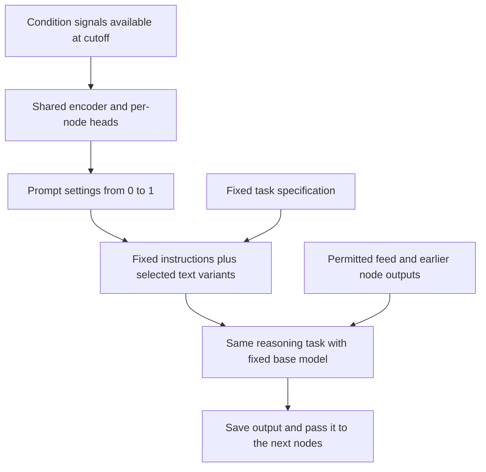

# Research direction: context-conditioned prompt selection

> **Experimental research proposal.** No controller has been implemented or evaluated.

The application class is forecasting a changing, partially observed system from heterogeneous, incomplete, overlapping and time-delayed perspectives. Reasoning reconciles meanings and availability clocks, separates missing from conflicting evidence, proposes competing explanations, selects explicit targets and saves the support chain. Feeds are not independent votes. Observations must share system/entity/time linkage, and declared targets and horizons must have later measurable truth. The disclosed recurrence is a protocol fixture, not evidence that language-model reasoning is necessary or outperforms direct or numerical baselines.

A greenhouse is a concrete motivating case: sensors report temperature and humidity, soil readings describe another subsystem, weather supplies context, door logs record events, and irrigation or ventilation records describe planned/executed controls. Declare a six-hour temperature or humidity target and later measure that same quantity. The graph should distinguish an outage from conflicting readings and recognise that two weather summaries may repeat one source. Equipment networks and laboratory experiments offer other candidate applications. None has been evaluated, and the disclosed System A recurrence is not a simulator of these systems.

The aim is to learn an efficient reasoning graph that remains useful across
different observed system conditions. The proposal below is not implemented or validated
by the [current preparation example](demo.md). It has no completed forecast.
Robustness to every possible regime is an ambition, not a result or guarantee.

The proposed design is one shared controller that reads current conditions,
small per-node outputs that select semantic settings, and a renderer that turns
those settings into exact prompt text. Each reasoning node does the same job
under slightly different interpretive guidance. Later measured errors train or
select the controller, with the language model and evaluation rules held fixed.

## Terminology and closest prior work

The proposal is **context-conditioned prompt selection**: observed conditions
determine which text variants a node receives. This is a description of the
proposed mechanism, not a claim to have introduced a new established method.
A **language-model program** is the broader literature's term for the composed
calls and their data flow. Here the existing node graph is such a program.

| Term | Meaning in this proposal |
|---|---|
| Prompt setting | A scalar in `[0,1]` used to select a text variant for one component. Settings need not sum to one. |
| Controller parameters | The trainable numerical weights inside the shared encoder and its per-node output heads. |
| Fixed task specification | The node's job, permitted evidence, ranking rules, required checks and output contract; the fixed part of its dossier. |
| Discrete prompt optimisation | Searching or selecting actual text, evaluated through model calls and a declared metric. |
| Failure attribution | A hypothesis about where an error arose, requiring an intervention test before a causal claim. |

Calling a setting a “prompt weight” can obscure the difference between an
instruction selector and a neural-network parameter. Neither a selected scalar
nor an emphatic sentence directly multiplies the model's attention. The proposed
text lookup also differs from [soft prompt tuning](https://arxiv.org/abs/2104.08691v2),
which learns continuous prompt representations by backpropagation while keeping
the language model frozen. Here the adjustable prompt components are discrete text.

Four primary papers provide the closest methodological grounding:

| Source and passage | Relevant method | Boundary of the comparison |
|---|---|---|
| Khattab et al., [DSPy](https://arxiv.org/abs/2310.03714), §§2–3 | Composes LM modules with input/output signatures and optimises a program against a metric. | The abstraction helps separate each node's task from its prompt. DSPy also supports methods, including fine-tuning, that this proposal does not adopt. |
| Opsahl-Ong et al., [MIPRO](https://arxiv.org/abs/2406.11695v2), §§2–4, Algorithm 1 | Proposes per-module instructions and demonstrations, then uses measured downstream scores to search their combinations. | A reference for discrete configuration search and credit assignment. Zenith's regime-conditioned selection and chronological evaluation remain separate, untested design choices. |
| Pryzant et al., [ProTeGi](https://arxiv.org/abs/2305.03495), §2 | Uses error descriptions to propose prompt edits, with beam search and candidate selection. | “Textual gradients” are an analogy for verbal feedback. They supply neither derivatives through the API nor evidence that a particular diagnosis is causally correct. |
| Yuksekgonul et al., [TextGrad](https://arxiv.org/abs/2406.07496v1), §2 | Propagates textual feedback through a computation graph to revise selected variables. | A close precedent for graph-based feedback. The paper explicitly treats differentiation as a metaphor; its reported task results do not establish predictive performance here. |

These papers support the terminology and method comparisons. They do not prove
the usefulness, novelty or robustness of Zenith's proposed controller. AlphaGo
Zero and autoresearch remain earlier motivations for successive comparisons;
they are not substitutes for this nearer prompt-optimisation literature.

## A snapshot can contain a history

“Point in time” describes the information cutoff, not the number of observations
inside the packet. A saved packet could hold one current state, or measurement paths,
dated events, interventions and other histories available by that cutoff. In the photo/video
analogy, a history-bearing snapshot contains a bounded video up to that moment.
It remains a finite, sampled record, not complete continuous knowledge.

| Input available at the cutoff | Forecast target | What the comparison can establish |
|---|---|---|
| One recorded state, like a photo | A later state | Error at the declared horizon |
| Histories inside a saved packet, like a video so far | A later state | Whether past dynamics help the same endpoint task |
| Those histories | A future path over declared times | Path accuracy under a separately defined target and loss |

An accurate endpoint does not establish an accurate path. Separate forecasts at
several horizons do not, by themselves, specify a joint distribution over future
paths. Select the target, sampling interval, horizon and score before comparing
versions. Keep analysis-window width separate from forecast horizon.

A future study would use authorised observation snapshots with
reliable historical availability records. Each observation needs its event time,
publication or availability time, collection time, and revision vintage where
applicable. Later corrections must not silently appear in earlier inputs.
The synthetic example provides declared clocks for teaching; it does not certify
availability in a real deployment. More data alone does not repair unreliable
clocks or a model's possible knowledge of later events. Private payloads stay
outside the public repo.

## What a prompt setting controls

Each node would receive a dossier assembled from a shared core, its own task
contract, and several adjustable text components. **The node keeps the same
job, permitted inputs, work budget and output contract at every setting.** A
setting makes a small semantic variation in how it performs that job. It does
not select a different task, add extra investigation or change the required
amount of work. The shared core fixes evidence boundaries and uncertainty
reporting; optimisation cannot weaken those requirements.

The interventions miner reads its feed and the seed-state inventory. Its fixed task
preserves timestamp admissibility, source references, relevance ranking,
deduplication and output structure. A proposed semantic component would vary
interpretation of changes following recorded interventions without changing those rules.

For example, one axis could control **caution about attributing a change to an
intervention**. These fragments accompany the same fixed task and inputs:

| Setting | Small variation in the interpretation guidance |
|---|---|
| `0.0` | Describe the recorded intervention and nearby observations; retain uncertainty about attribution. |
| `0.1` | Treat temporal association as a possible explanation while noting that it does not prove an effect. |
| `0.2` | Give slightly more emphasis to alternative explanations for the observed change where supported. |
| `1.0` | Give those alternatives the strongest emphasis allowed by this component without overriding supplied evidence. |

The permitted inputs remain seed state and the interventions feed. Timestamp
admissibility, source references, deduplication and output structure are fixed.
Temporal association alone is not causal proof.

The endpoint is the end of a bounded interpretive range, not unlimited
scepticism. Every variant still reports the same factual measurements and
follows the same ranking and evidence rules. Other components could vary
other narrowly specified interpretive choices, each with its own meaning.
Whether any such variation helps is an experimental question.

A versioned lookup turns each setting into exact wording. Intermediate values
need an explicit rule, such as nearest available variant with a fixed tie-break;
a finer grid would require more deliberately written variants. The renderer
does not blend sentences arithmetically, and the number is not an internal LLM
attention weight. A larger setting need not improve performance. Small text
changes can still produce large or non-monotonic behavioural changes, so their
semantic closeness and actual effects both need checking.

The settings are independent controls, not probabilities that must sum to one.
Token budget and required work stay fixed in this proposal. Save the complete rendered prompt and its hash, the lookup-table
version, and the settings for every run. Two different numbers that render the
same prompt are the same textual intervention, not two different treatments.

## Generalise across the reasoning graph

Use one shared context encoder and a small output head for each reasoning node.
The shared encoder reads the declared cutoff-available signals; each head
selects settings for that node's few, named semantic components. A renderer
then compiles the node's dossier from the common core, its unchanged task
contract and the selected wording. This is a proposal for all suitable
reasoning nodes, not an interventions-only mechanism.

| Node role | Same job throughout | Example of a bounded interpretive axis |
|---|---|---|
| Seed | Describe data coverage and quality | Emphasis on possible regime dependence of a quality concern; factual coverage unchanged |
| Feed miner | Extract that lane's signals under its fixed rules | Interpretation of an observed move as durable information versus incomplete evidence |
| Cross-feed synthesis | Relate the supplied observations | Caution about a shared regime explaining co-movement; no invented causal link |
| Orient | Form competing explanations | Relative interpretive emphasis on persistence versus a supported regime transition |
| Decide | Assess the same theses and freeze its checkpoint | Sensitivity to regime dependence in the stated assumptions; forecast and output obligations unchanged |
| Directed miner | Recheck the same thesis against its feed | Interpretation of ambiguous confirming or contradicting evidence |
| Director | Reconcile the findings into the final record | Interpretation of residual disagreement; locked quantities and schema remain fixed |

These examples specify possible axes, not good policies. They must be checked
against each node's actual contract before any implementation. The settings
must not become knobs for inventing confidence, changing factual inputs or
ignoring counterevidence. The same signal may warrant different settings in
different nodes; one global interpretive setting need not suit every role.

The encoder and heads can be an actual small neural network with trainable
numerical weights. Its outputs are the semantic settings, which are distinct
from its internal weights. Begin with few shared features and few axes to
limit the number of parameters. Sharing an encoder is a design proposal, not
a demonstrated advantage. Compare it with a fixed mapping before expanding it.

Feed artifacts and deterministic computations do not need pretend prompt
weights. Integrity checks, evidence cutoffs and the numerical scoring rule
stay fixed. Oracle's explanatory prompts or Evolve's proposal prompts could
later use the same mechanism within their own duties, but assess them
separately against a frozen evaluation procedure. Never let the candidate
improve its score by changing the judge or loosening a validator.

## External signals choose the settings

Variability, missingness, source disagreement and event density, could feed
the shared controller. It would output a vector of settings, one for each adjustable
component of each node. The renderer turns those settings into prompt text.
Thus the prompt varies with the observed conditions; it is not one fixed prompt
with a different number mentioned in it.

This is the prediction-time path for one node; its controller has already been
fitted and frozen. Development is a separate sequence: evaluate configurations
on development cases, fit or select a controller from their measured losses,
then freeze it before testing later cases. There is no arrow from a test
outcome back into the controller that produced that same forecast.

These features must come from observations actually available at the cutoff,
not later outcomes or labels assigned after evaluation. They are incomplete
summaries, not a complete model of system dynamics. A signal remains an input
when it reaches a node through selected wording. Record its source and
availability; give comparison policies the same information access.

Start with fixed, interpretable mappings and compare them with a fixed-prompt
baseline. Learning whether a signal should affect a particular interpretive component
is itself part of the research. No feature has a pre-established beneficial
mapping to prompt settings. Missing or unfamiliar signals need a declared fallback,
and changing regimes may make a previously useful mapping fail.

## Where neural-network ideas apply

A neural network adjusts numerical parameters using a loss. Backpropagation
uses the local derivatives of its operations to assign gradient information to
those parameters. [micrograd's implementation](https://github.com/karpathy/micrograd/blob/7bc720e951fe422b8f8814aa5aa1b64121d26b4c/micrograd/engine.py)
shows this directly: arithmetic operations define backward rules and the final
backward pass visits their graph in reverse dependency order.

Zenith's prompt lookup and hosted text generation do not expose that
differentiable path. With a hard lookup, changing a setting slightly often
changes nothing, then abruptly selects different text. Tracing a bad forecast
back through node records therefore does not compute a gradient. An Oracle
critique can propose a change; its confidence is not a derivative.

Three approaches are plausible research choices:

1. **Search the discrete settings.** Evaluate bounded changes to text variants
   or controller mappings, then keep only improvements supported on separate
   later cases. This is the closest continuation of the current experiment.
   [DSPy's MIPROv2](https://github.com/stanfordnlp/dspy/blob/f1260ff14610286cb295c7d3a5ee2cbfd0ba5cb9/dspy/teleprompt/mipro_optimizer_v2.py)
   provides a concrete reference for proposing instructions and searching
   combinations using measured scores. Its optimisation set is not a final
   untouched test set.
2. **Train a numerical controller over a small catalogue.** On training cases,
   evaluate each allowed configuration and record its forecast loss and cost.
   A controller can learn probabilities over those configurations from features
   available at the cutoff. Backpropagation can minimise the probability-weighted
   measured losses through the controller, treating the recorded losses as
   fixed numbers. That objective is the expected loss of choosing a configuration,
   not the loss of averaging its forecasts. Evaluate any final deterministic
   choice separately. There is still no gradient through the underlying LLM.
3. **Sample configurations and estimate a policy gradient.** When evaluating
   every configuration is too expensive, sampled choices and their measured
   rewards could update a stochastic controller. The
   [PyTorch REINFORCE example](https://github.com/pytorch/examples/blob/acc295dc7b90714f1bf47f06004fc19a7fe235c4/reinforcement_learning/reinforce.py)
   illustrates backpropagation through action log-probabilities weighted by
   observed returns. It does not differentiate the environment. Applying that
   pattern here would require explicit sampling probabilities, careful handling
   of noise and delayed outcomes, and fresh later evaluation; the example does
   not establish that it works for these reasoning tasks.

These are alternatives to investigate, not new dependencies or a claim that
Zenith already trains a neural controller. The base language-model weights
would remain fixed; the controller would have its own trainable parameters.
That makes the controller a neural network when implemented as one; it does
not make the entire language-based graph an ordinarily differentiable network.
Optimising the text lookup, controller and graph structure all at once would
make attribution harder. Freeze the others while testing one change first.

## How to test the larger idea

Complete the existing graph before training on its forecast errors. Then use
chronologically separated development, selection and later test blocks. Keep
overlapping target periods from crossing the split; only admit training cases
whose outcomes were available before the tested policy was frozen. Fit feature
scales and the controller on the development data only. Repeatedly choosing a
winner on the same later block turns that block into development data.

Compare a fixed prompt, a fixed signal-to-setting rule and a learned controller
under the same data access and declared compute budget. Report execution
failures, forecast error, selection coverage, uncertainty calibration and cost
separately. Declare how abstentions and failed forecasts are scored. Do not
reward a system merely for issuing fewer predictions or producing valid JSON.

Measure performance across predefined conditions and regime transitions, along
with average and worst-group results and uncertainty from the limited sample.
Test whether the regime-conditioned version adds value over a simpler fixed
graph. Missing information and unforeseen events can leave several futures
compatible with the same past. The target is useful, efficient forecasting
with honest uncertainty across diverse conditions, not guaranteed prediction
in every possible situation.

Page 3 of the [three-page paper](../paper/zenith.pdf) diagrams this mechanism.
The [spoken walkthrough](zenith-walkthrough-script.md) explains it in plain language.
The implementation references above were inspected on 12 October 2026; their
ideas are credited without claiming that their results transfer to this task.

## Physical problem setting

The proposed use is a partially observed dynamical system. Sensors expose different functions or aspects of state; available histories and known forces, boundaries and interventions condition its future. A position measurement alone need not reveal velocity or direction. History may help, but some state remains unobservable and identifiability is not universal. See Russ Tedrake's [Output Feedback](https://underactuated.mit.edu/output_feedback.html) and [System Identification](https://underactuated.mit.edu/sysid.html).

Heat transfer could combine temperature, heater power, weather and door/vent observations for a six-hour chamber or greenhouse temperature target. Damped vibration could combine camera position, accelerometer readings and force/calibration logs for a one-second displacement or acceleration target. Fluid transport could combine flow, pressure, dye and valve records for downstream concentration; geometry and boundary conditions are necessary inputs.

The graph's proposed job is to align clocks, units and dependent sources; compare sensor-fault with state/regime explanations; select or parameterise a suitable physical model or numerical tool; and freeze target, horizon and uncertainty. Narrative cannot replace equations. Solver integration and transfer to these applications are unimplemented and untested. The disclosed System A recurrence remains a separate protocol fixture, without physical interpretation. Common entity/time linkage and later measurable truth remain required.

A concrete next proposal is a damped driven oscillator with position, acceleration and force histories, calibration, event and control records, and deliberately delayed, duplicated or faulty sensors. Keep hidden fault truth exclusively with the evaluator. Score future-state prediction separately from fault diagnosis. Compare a numerical observer/solver, a direct language-model forecast, the graph and one revised graph under equal information cutoffs and budgets. This experiment is proposed, not implemented. The reasoning DAG is a computational dependency graph, not a physical causal diagram; feedback in the physical system does not require a cycle in each forecast's analysis graph.
