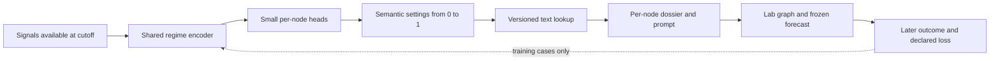

# Research direction: prompts controlled by learned settings

> **This is not financial advice.** This is a theoretical research proposal.
> Historical examples and model outputs are not investment recommendations and
> must not be used to make financial decisions. See the [research notice](../RESEARCH_NOTICE.md).

The aim is to learn an efficient reasoning graph that remains useful across
different market conditions. The proposal below is not implemented or validated
by the [current execution experiment](original-feed-windows.md). That experiment
tested one fixed instruction change and did not produce a completed forecast.
Robustness to every possible regime is an ambition, not a result or guarantee.

The proposed design is one shared controller that reads current conditions,
small per-node outputs that select semantic settings, and a renderer that turns
those settings into exact prompt text. Each reasoning node does the same job
under slightly different interpretive guidance. Later measured errors train or
select the controller, with the language model and evaluation rules held fixed.

## A snapshot can contain a history

“Point in time” describes the information cutoff, not the number of observations
inside the packet. A saved packet could hold one current state, or price paths,
dated news, flows and other histories available by that cutoff. In the photo/video
analogy, a history-bearing snapshot contains a bounded video up to that moment.
It remains a finite, sampled record, not complete continuous knowledge.

| Input available at the cutoff | Forecast target | What the comparison can establish |
|---|---|---|
| One recorded state, like a photo | A later state | Error at the declared horizon |
| Histories inside a saved packet, like a video so far | A later state | Whether past dynamics help the same endpoint task |
| Those histories | A future path over declared times | Path accuracy under a separately defined target and loss |

An accurate endpoint does not establish an accurate path. Separate forecasts at
several horizons do not, by themselves, specify a joint distribution over future
paths. Select the target, sampling interval, horizon and score before comparing
versions. Keep analysis-window width separate from forecast horizon.

A future study would use authorised proprietary financial snapshots with
reliable historical availability records. Each observation needs its event time,
publication or availability time, collection time, and revision vintage where
applicable. Later corrections must not silently appear in earlier inputs.
The present archived captures do not establish all of these clocks. More data
alone does not repair that limitation, or a current model's possible knowledge
of later events. Private licences and raw payloads stay outside the public repo.

## What a prompt weight would mean

Each node would receive a dossier assembled from a shared core, its own task
contract, and several adjustable text components. **The node keeps the same
job, permitted inputs, work budget and output contract at every setting.** A
setting makes a small semantic variation in how it performs that job. It does
not select a different task, add extra investigation or change the required
amount of work. The shared core fixes evidence boundaries and uncertainty
reporting; optimisation cannot weaken those requirements.

The existing [Polymarket miner](../codex/substrate/nodes/lab/miner_poly.json)
reads the Polymarket feed and seed-state data topology. It extracts ranked
signals as atomic tuples. Its current instruction fixes probability filters,
ranking by absolute probability change, deduplication and output structure.
A proposed semantic component would vary the interpretive guidance for the
same signals, particularly their Context/Implication field, while preserving
those extraction rules. It would not turn this miner into a forecaster.

For example, one axis could control **caution about sentiment-driven apparent
consensus**. These are illustrative fragments appended to the same fixed task:

| Setting | Small variation in the interpretation guidance |
|---|---|
| `0.0` | Interpret the reported probability change in its supplied context; retain the stated uncertainty. |
| `0.1` | Interpret the same change with mild caution about sentiment-driven consensus where the evidence supports it. |
| `0.2` | Give slightly more interpretive weight to sentiment-driven consensus as a possible explanation, where supported. |
| `1.0` | Give that explanation the strongest emphasis allowed by this component, without assuming consensus is wrong or overriding the supplied evidence. |

The endpoint is the end of a bounded interpretive range, not unlimited
scepticism. Every variant still reports the same factual measurements and
follows the same ranking and evidence rules. Other components could vary
other narrowly specified interpretive choices, each with its own meaning.
Whether any such variation helps is an experimental question.

A versioned lookup turns each setting into exact wording. Intermediate values
need an explicit rule, such as nearest available variant with a fixed tie-break;
a finer grid would require more deliberately written variants. The renderer
does not blend sentences arithmetically, and the number is not an internal LLM
attention weight. A larger setting need not improve performance. Small text
changes can still produce large or non-monotonic behavioural changes, so their
semantic closeness and actual effects both need checking.

The settings are independent controls, not probabilities that must sum to one.
Token budget and required work stay fixed in this proposal. Save the complete rendered prompt and its hash, the lookup-table
version, and the settings for every run. Two different numbers that render the
same prompt are the same textual intervention, not two different treatments.

## Generalise across the reasoning graph

Use one shared regime encoder and a small output head for each reasoning node.
The shared encoder reads the declared cutoff-available signals; each head
selects settings for that node's few, named semantic components. A renderer
then compiles the node's dossier from the common core, its unchanged task
contract and the selected wording. This is a proposal for all suitable
reasoning nodes, not a Polymarket-only mechanism.

| Node role | Same job throughout | Example of a bounded interpretive axis |
|---|---|---|
| Seed | Describe data coverage and quality | Emphasis on possible regime dependence of a quality concern; factual coverage unchanged |
| Feed miner | Extract that lane's signals under its fixed rules | Interpretation of an observed move as durable information versus sentiment-sensitive evidence |
| Cross-feed synthesis | Relate the supplied observations | Caution about a shared regime explaining co-movement; no invented causal link |
| Orient | Form competing explanations | Relative interpretive emphasis on persistence versus a supported regime transition |
| Decide | Assess the same theses and freeze its checkpoint | Sensitivity to regime dependence in the stated assumptions; forecast and output obligations unchanged |
| Directed miner | Recheck the same thesis against its feed | Interpretation of ambiguous confirming or contradicting evidence |
| Director | Reconcile the findings into the final record | Interpretation of residual disagreement; locked quantities and schema remain fixed |

These examples specify possible axes, not good policies. They must be checked
against each node's actual contract before any implementation. The settings
must not become knobs for inventing confidence, changing factual inputs or
ignoring counterevidence. The same signal may warrant different settings in
different nodes; one global “greed weight” need not suit every role.

The encoder and heads can be an actual small neural network with trainable
numerical weights. Its outputs are the semantic settings, which are distinct
from its internal weights. Begin with few shared features and few axes to
limit the number of parameters. Sharing an encoder is a design proposal, not
a demonstrated advantage. Compare it with a fixed mapping before expanding it.

Feed artifacts and deterministic computations do not need pretend prompt
weights. Integrity checks, evidence cutoffs and the numerical scoring rule
stay fixed. Oracle's explanatory prompts or Evolve's proposal prompts could
later use the same mechanism within their own duties, but assess them
separately against a frozen evaluation procedure. Never let the candidate
improve its score by changing the judge or loosening a validator.

## External signals choose the settings

An external signal such as VIX, alongside other available features, could feed
the shared controller. It would output a vector of settings, one for each adjustable
component of each node. The renderer turns those settings into prompt text.
Thus the prompt varies with the observed conditions; it is not one fixed prompt
with a different number mentioned in it.

VIX estimates expected 30-day S&P 500 volatility from option quotations. It is
one possible feature, not a complete measurement of market stress, a direction
forecast, or a label for every regime. See [Cboe's definition](https://www.cboe.com/tradable_products/vix/faqs).
A separate greed or sentiment index would measure a different proposed
feature; VIX is not a greed score. The controller must use values actually
available at the cutoff, not later realised volatility or a regime label
assigned after the outcome. A signal is an input even if it reaches the node
only through the selected wording. Record its source and availability, and
give comparison policies the same information access.

Start with fixed, interpretable mappings and compare them with a fixed-prompt
baseline. Learning whether a signal should affect a particular interpretive component
is itself part of the research. Do not assume “higher VIX means more
scepticism” or “greed means consensus is wrong” is the right rule. Missing or unfamiliar signals need a declared fallback,
and changing regimes may make a previously useful mapping fail.

## Where neural-network ideas apply

A neural network adjusts numerical parameters using a loss. Backpropagation
uses the local derivatives of its operations to assign gradient information to
those parameters. [micrograd's implementation](https://github.com/karpathy/micrograd/blob/7bc720e951fe422b8f8814aa5aa1b64121d26b4c/micrograd/engine.py)
shows this directly: arithmetic operations define backward rules and the final
backward pass visits their graph in reverse dependency order.

Zenith's prompt lookup and hosted text generation do not expose that
differentiable path. With a hard lookup, changing a setting slightly often
changes nothing, then abruptly selects different text. Tracing a bad forecast
back through node records therefore does not compute a gradient. An Oracle
critique can propose a change; its confidence is not a derivative.

Three approaches are plausible research choices:

1. **Search the discrete settings.** Evaluate bounded changes to text variants
   or controller mappings, then keep only improvements supported on separate
   later cases. This is the closest continuation of the current experiment.
   [DSPy's MIPROv2](https://github.com/stanfordnlp/dspy/blob/f1260ff14610286cb295c7d3a5ee2cbfd0ba5cb9/dspy/teleprompt/mipro_optimizer_v2.py)
   provides a concrete reference for proposing instructions and searching
   combinations using measured scores. Its optimisation set is not a final
   untouched test set.
2. **Train a numerical controller over a small catalogue.** On training cases,
   evaluate each allowed configuration and record its forecast loss and cost.
   A controller can learn probabilities over those configurations from features
   available at the cutoff. Backpropagation can minimise the probability-weighted
   measured losses through the controller, treating the recorded losses as
   fixed numbers. That objective is the expected loss of choosing a configuration,
   not the loss of averaging its forecasts. Evaluate any final deterministic
   choice separately. There is still no gradient through the underlying LLM.
3. **Sample configurations and estimate a policy gradient.** When evaluating
   every configuration is too expensive, sampled choices and their measured
   rewards could update a stochastic controller. The
   [PyTorch REINFORCE example](https://github.com/pytorch/examples/blob/acc295dc7b90714f1bf47f06004fc19a7fe235c4/reinforcement_learning/reinforce.py)
   illustrates backpropagation through action log-probabilities weighted by
   observed returns. It does not differentiate the environment. Applying that
   pattern here would require explicit sampling probabilities, careful handling
   of noise and delayed outcomes, and fresh later evaluation; the example does
   not establish that it works for financial prompts.

These are alternatives to investigate, not new dependencies or a claim that
Zenith already trains a neural controller. The base language-model weights
would remain fixed; the controller would have its own trainable parameters.
That makes the controller a neural network when implemented as one; it does
not make the entire language-based graph an ordinarily differentiable network.
Optimising the text lookup, controller and graph structure all at once would
make attribution harder. Freeze the others while testing one change first.

## How to test the larger idea

Complete the existing graph before training on its forecast errors. Then use
chronologically separated development, selection and later test blocks. Keep
overlapping target periods from crossing the split; only admit training cases
whose outcomes were available before the tested policy was frozen. Fit feature
scales and the controller on the development data only. Repeatedly choosing a
winner on the same later block turns that block into development data.

Compare a fixed prompt, a fixed signal-to-setting rule and a learned controller
under the same data access and declared compute budget. Report execution
failures, forecast error, selection coverage, uncertainty calibration and cost
separately. Declare how abstentions and failed forecasts are scored. Do not
reward a system merely for issuing fewer predictions or producing valid JSON.

Measure performance across predefined conditions and regime transitions, along
with average and worst-group results and uncertainty from the limited sample.
Test whether the regime-conditioned version adds value over a simpler fixed
graph. Missing information and unforeseen events can leave several futures
compatible with the same past. The target is useful, efficient forecasting
with honest uncertainty across diverse conditions, not guaranteed prediction
in every possible situation.

Page 3 of the [four-page paper](../paper/zenith.pdf) diagrams this mechanism.
The [spoken walkthrough](zenith-walkthrough-script.md) explains it in plain language.
The implementation references above were inspected on 12 October 2026; their
ideas are credited without claiming that their results transfer to this task.
